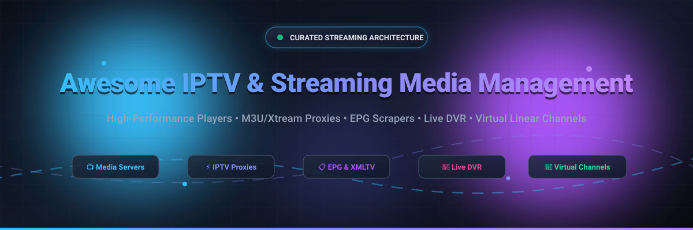

# 📺 Awesome IPTV & Streaming Media Management 🚀

  
  
  
  
  
  
  

  <strong>🌟 A curated directory of top IPTV streaming clients, M3U/Xtream proxy servers, EPG XMLTV scrapers, live TV DVR backends, and self-hosted personal media centers. 🌟</strong>

  <a href="#-sector-overview--market-dynamics">Sector Overview</a> •
  <a href="#-saashosted-platforms">SaaS Platforms</a> •
  <a href="#-open-source-equivalents--tools">Open-Source Tools</a> •
  <a href="#-star-history">Star History</a> •
  <a href="#-support--sponsor">Support</a> •
  <a href="#-contributing">Contributing</a>

---

## 📖 Introduction & SEO Overview

Welcome to **Awesome IPTV & Streaming Media Management** — the comprehensive, open-source knowledge base designed for homelab enthusiasts, cord-cutters, IPTV operators, and streaming system administrators. Whether you are seeking high-efficiency **M3U/Xtream tuners**, automated **EPG (Electronic Program Guide)** XMLTV grabbers, **DVR scheduling engines**, or custom **linear 24/7 TV channel builders**, this repository indexes production-ready solutions across self-hosted and cloud environments.

---

## 📊 Sector Overview & Market Dynamics

The global Internet Protocol Television (IPTV) and streaming media management sector represents an estimated market size exceeding **$55 billion to $100+ billion**, expanding at a robust 12%–17% CAGR driven by worldwide fiber-optic (FTTH) broadband deployments, 4K/8K media adoption, and cord-cutting acceleration. 

The sector is **highly fragmented**, characterized by a competitive distribution among incumbent telecom infrastructure providers, enterprise B2B middleware suites, boutique cloud hosts, and a fast-growing ecosystem of independent player applications and open-source homelab servers rather than a single winner-take-all monopoly.

---

## 📋 Table of Contents

- [📊 Sector Overview & Market Dynamics](#-sector-overview--market-dynamics)
- [💼 SaaS/Hosted Platforms](#-saashosted-platforms)
- [🔓 Open-Source Equivalents & Tools](#-open-source-equivalents--tools)
  - [🖥️ Full-Featured Self-Hosted IPTV & Media Servers](#️-full-featured-self-hosted-iptv--media-servers)
  - [🔀 IPTV Proxies, Tuner Emulators & Stream Restreamers](#-iptv-proxies-tuner-emulators--stream-restreamers)
  - [📱 Cross-Platform IPTV Players & Clients](#-cross-platform-iptv-players--clients)
  - [📅 EPG (Electronic Program Guide) Scrapers & Playlist Managers](#-epg-electronic-program-guide-scrapers--playlist-managers)
  - [📡 Custom Live TV Channel Generators & Media Automation](#-custom-live-tv-channel-generators--media-automation)
- [⭐ Star History](#-star-history)
- [💖 Support & Sponsor](#-support--sponsor)
- [🤝 Contributing](#-contributing)

---

## 💼 SaaS/Hosted Platforms

Commercial, proprietary IPTV player applications, cloud-authenticated media server subscriptions, and hosted live TV middleware suites.

| Platform / Product | Description | Company Size (Valuation / Revenue) | Pricing (Starting Tier) | Free Tier / Trial Limits |
| :--- | :--- | :--- | :--- | :--- |
| **[Plex Media Server & Plex Pass](https://plex.tv)** | Proprietary media server with cloud authentication, live TV/DVR tuner support, and commercial EPG guide data. | ~$100M–$250M Est. Valuation ($132M total funding raised) | $6.99/month (or $69.99/year, $749.99 lifetime) | Free forever for local home-network streaming; remote streaming outside home limited to 1 min without Remote Watch Pass ($2.99/mo) or Plex Pass. |
| **[Stalker Middleware / Ministra TV Platform](https://infomir.eu)** | Commercial enterprise IPTV/OTT middleware platform used by operators for portal management and set-top-box delivery. | ~$15M–$50M Est. Group Revenue (Infomir Pro OÜ subsidiary recorded ~€6.6M annual turnover) | $29.99 one-time license per client device (Ministra Player); operator backend quotes on request | Free server platform license included exclusively when deploying Infomir MAG set-top-box hardware; non-Infomir hardware requires paid license. |
| **[Emby Premiere](https://emby.media)** | Commercial personal media server offering live TV streaming, M3U/XMLTV ingestion, hardware transcoding, and multi-device DVR. | ~$5M–$10M Est. Annual Revenue (Self-funded / Bootstrapped) | $4.99/month (or $54.00/year, $119.00 lifetime) | Free forever for basic local server and library management; mobile & TV client video playback limited to 1 minute playback test without Premiere. |
| **[IPTV Smarters Pro](https://iptvsmarters.com)** | Commercial cross-platform OTT/IPTV player supporting Xtream Codes API, M3U playlists, and multi-screen playback. | ~$2M–$5M Est. Annual Revenue (WHMCS Smarters) | $18.00 one-time lifetime license per device | Free forever player with standard single-screen stream playback and ads; premium multi-screen and advanced customization require lifetime unlock. |
| **[TiviMate IPTV Player](https://tivimate.com)** | Popular proprietary Android TV/Google TV IPTV client known for its modern cable-like EPG interface, multi-view, and catch-up support. | ~$1M–$3M Est. Annual Revenue (Indie developer: Armobsoft FZE) | $9.99/year (or $34.99 lifetime, covers up to 5 devices) | 5-day to 7-day free trial on the annual subscription plan (via Google Play); basic free mode allows single playlist without multi-view, recording, or catch-up. |
| **[OTT Navigator IPTV](https://ottnavigator.com)** | Proprietary Android/TV IPTV player featuring advanced playlist filtering, picture-in-picture, and Xtream/Stalker portal compatibility. | ~$500K–$1.5M Est. Annual Revenue (Indie developer: SIA SC ANVERT) | $1.49/month (or $19.99 one-time lifetime) | Free forever player with baseline playlist playback; premium locks picture-in-picture, archive recording, and advanced codec adjustments. |
| **[GSE Smart IPTV](https://gsesmartiptv.com)** | Proprietary media player for iOS, Apple TV, and Android supporting live streaming, EPG timelines, and Chromecast casting. | ~$300K–$1M Est. Annual Revenue (Droidvision) | $2.99 one-time in-app purchase (or $4.99/month on iOS subscription variants) | Free forever with ad banner displays and core playlist loading; recording, Chromecast, and advanced EPG timelines require pro unlock. |
| **[Perfect Player IPTV](https://niklabs.com)** | Classic proprietary set-top-box style IPTV/media player supporting M3U, XSPF, and JTV/XMLTV EPG formats. | ~$200K–$500K Est. Annual Revenue (Niklabs Software) | $4.99 one-time in-app purchase | Free forever with advertisements and basic OSD menu controls; ad removal and advanced decoding options require paid unlock. |
| **[Jellyfin Cloud / Kodi Cloud (Managed Hosting)](https://elfhosted.com)** | Third-party commercial cloud-hosted seedbox and container platforms offering turnkey managed Jellyfin, Kodi, and IPTV stacks. | ~$100K–$250K Annual Revenue / MRR (Public open startup by ElfHosted) | $9.00/month (standalone Jellyfin app; full media bundles start at $18.00/month) | 7-day trial available for $1 with full dedicated container microservice access; no permanent free tier. |

---

## 🔓 Open-Source Equivalents & Tools

Free and open-source software (FOSS) self-hosted media servers, M3U/HDHomeRun proxies, cross-platform IPTV clients, EPG aggregators, and custom TV channel builders. Sorted in descending order by GitHub stargazers count within each category.

### 🖥️ Full-Featured Self-Hosted IPTV & Media Servers

* **[Jellyfin](https://github.com/jellyfin/jellyfin)**  - The premier 100% free and open-source media system featuring built-in Live TV, M3U tuner ingestion, XMLTV EPG support, and DVR recording.
* **[Tvheadend](https://github.com/tvheadend/tvheadend)**  - Mature, open-source TV streaming server and digital video recorder for Linux supporting IPTV, DVB-S/S2, DVB-C, DVB-T, and ATSC.
* **[StreamVault IPTV](https://github.com/Davidona/StreamVault-IPTV)**  - Modern open-source IPTV streaming platform for organizing, restreaming, and managing live TV playlists.
* **[MythTV](https://github.com/MythTV/mythtv)**  - Legendary open-source digital video recorder and home theater suite with multi-tuner scheduling and network streaming.
* **[NextPVR](https://nextpvr.com)** - Cross-platform personal video recorder and live TV backend supporting IPTV M3U streams, HDHomeRun tuners, and Kodi/Jellyfin integration.

### 🔀 IPTV Proxies, Tuner Emulators & Stream Restreamers

* **[MediaMTX](https://github.com/bluenviron/mediamtx)**  - Zero-dependency, open-source real-time media server and proxy supporting HLS, WebRTC, RTSP, RTMP, and SRT restreaming.
* **[Streamlink](https://github.com/streamlink/streamlink)**  - Open-source CLI utility and Python library that extracts live streams from various platforms and pipes them into local media players.
* **[Dispatcharr](https://github.com/Dispatcharr/Dispatcharr)**  - Modern open-source IPTV stream manager, proxy, and EPG orchestrator featuring load balancing, failover streams, and web management UI.
* **[xTeVe](https://github.com/xteve-project/xTeVe)**  - Classic open-source M3U proxy and EPG mapping server written in Go for integrating IPTV streams into Plex and Emby.
* **[Threadfin](https://github.com/Threadfin/Threadfin)**  - Actively maintained open-source M3U proxy for Plex, Jellyfin, and Emby that emulates an HDHomeRun tuner with channel filtering and buffering.
* **[Telly](https://github.com/tellytv/telly)**  - IPTV tuner proxy emulator for Plex Media Server written in Go.
* **[Tuliprox](https://github.com/euzu/tuliprox)**  - High-performance IPTV reverse proxy and stream multiplexer for load balancing live streams.

### 📱 Cross-Platform IPTV Players & Clients

* **[MPV](https://github.com/mpv-player/mpv)**  - Minimalist, high-performance open-source media player widely used as the underlying playback engine for custom IPTV clients.
* **[Kodi](https://github.com/xbmc/xbmc)**  - Award-winning open-source home theater platform with official PVR IPTV Simple Client for M3U playlists, catch-up TV, and XMLTV guides.
* **[VLC Media Player](https://github.com/videolan/vlc)**  - Universally popular open-source multimedia player capable of playing M3U playlists, HLS, UDP multicast, and RTSP streams.
* **[IPTVnator](https://github.com/4gray/iptvnator)**  - Cross-platform open-source IPTV player application built with Electron/Tauri supporting M3U/M3U8, Xtream Codes, EPG, and TV archive.
* **[Open TV](https://github.com/Fredolx/open-tv)**  - Fast, lightweight cross-platform IPTV player written in Rust and Tauri with smooth hardware acceleration.
* **[Hypnotix](https://github.com/linuxmint/hypnotix)**  - Clean, native open-source IPTV streaming application developed by Linux Mint supporting M3U playlists, Xtream API, and local favorites.
* **[M3UAndroid](https://github.com/oxyroid/M3UAndroid)**  - Modern, Material You open-source IPTV player for Android and Android TV supporting M3U, Xtream, DLNA casting, and live recording.

### 📅 EPG (Electronic Program Guide) Scrapers & Playlist Managers

* **[iptv-org/iptv](https://github.com/iptv-org/iptv)**  - Massive community-maintained collection of publicly available IPTV channels from around the world in clean M3U format.
* **[Free-TV/IPTV](https://github.com/Free-TV/IPTV)**  - Curated collection of legal, free-to-air public television channels from around the globe.
* **[iptv-org/epg](https://github.com/iptv-org/epg)**  - Automated utility and repository for downloading and generating XMLTV EPG guides from hundreds of TV sources worldwide.
* **[EPGStation](https://github.com/l3tnun/EPGStation)**  - Web-based TV recording, scheduling, and EPG management system built with Node.js and TypeScript.
* **[Comskip](https://github.com/erikkaashoek/Comskip)**  - Commercial detector and chapter marker generator for recorded live TV streams.
* **[WebGrab+Plus](http://webgrabplus.com)** - Multi-site incremental XMLTV EPG grabber capable of collecting television program listings from global TV guide portals.

### 📡 Custom Live TV Channel Generators & Media Automation

* **[ErsatzTV](https://github.com/ErsatzTV/ErsatzTV)**  - Open-source software for configuring and streaming custom live linear TV channels from personal Jellyfin, Plex, or local media libraries.
* **[Tunarr](https://github.com/chrisbenincasa/tunarr)**  - Modern open-source platform to create custom live TV channels with schedules, commercials/bumpers, and EPG guides from local media.
* **[PlexTraktSync](https://github.com/Taxel/PlexTraktSync)**  - Two-way sync script connecting Plex and Trakt.tv for tracking watched history and ratings across devices.
* **[dizqueTV](https://github.com/vexorian/dizquetv)**  - Open-source application for creating custom simulated live TV channels and XMLTV guides from Plex and media libraries.

---

## ⭐ Star History

---

## 💖 Support & Sponsor

Thank you for exploring and utilizing **Awesome-IPTV-Streaming-Media-Management**! 🚀

If you find this curated directory helpful for your streaming setups, homelabs, or IPTV configurations, please consider supporting the project:
* ⭐ **Star** this repository on GitHub to help others discover it.
* 🍴 **Fork** and contribute new tools, players, and proxies.
* 📢 **Share** this collection with your fellow homelabbers and communities.
* ☕ **Buy me a coffee / Sponsor**: Support ongoing maintenance and curation via the [GitHub Sponsors Dashboard](https://github.com/sponsors/ishandutta2007).

---

## 🤝 Contributing

Contributions are warmly welcomed! 🌟 Feel free to open a Pull Request to add more open-source IPTV players, M3U/Xtream proxies, EPG scrapers, or live TV management platforms.

1. Fork the repository.
2. Add your project under the appropriate category with a concise description and correct repository link.
3. Submit a Pull Request.
